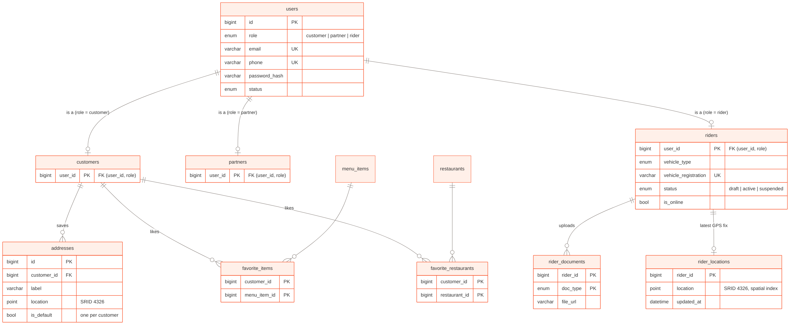
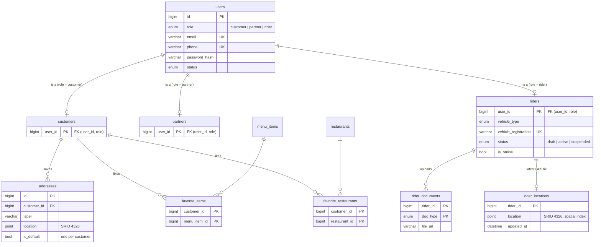
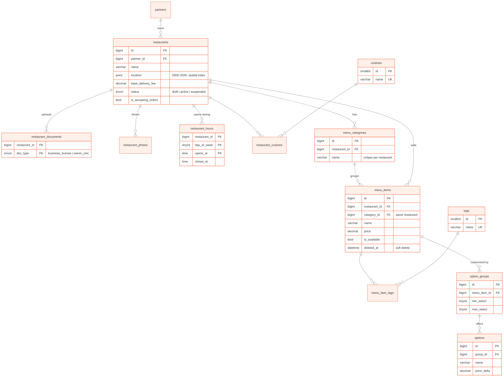
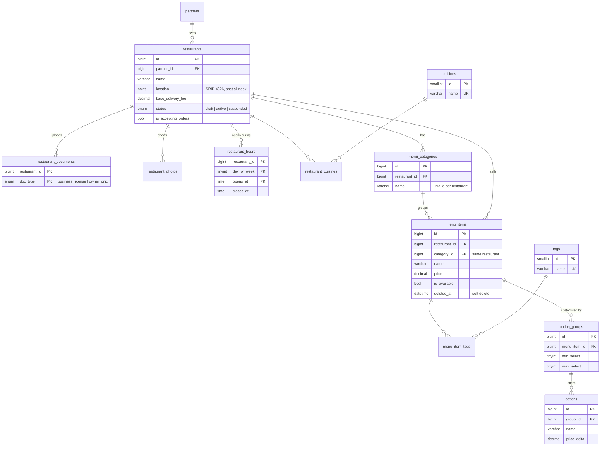
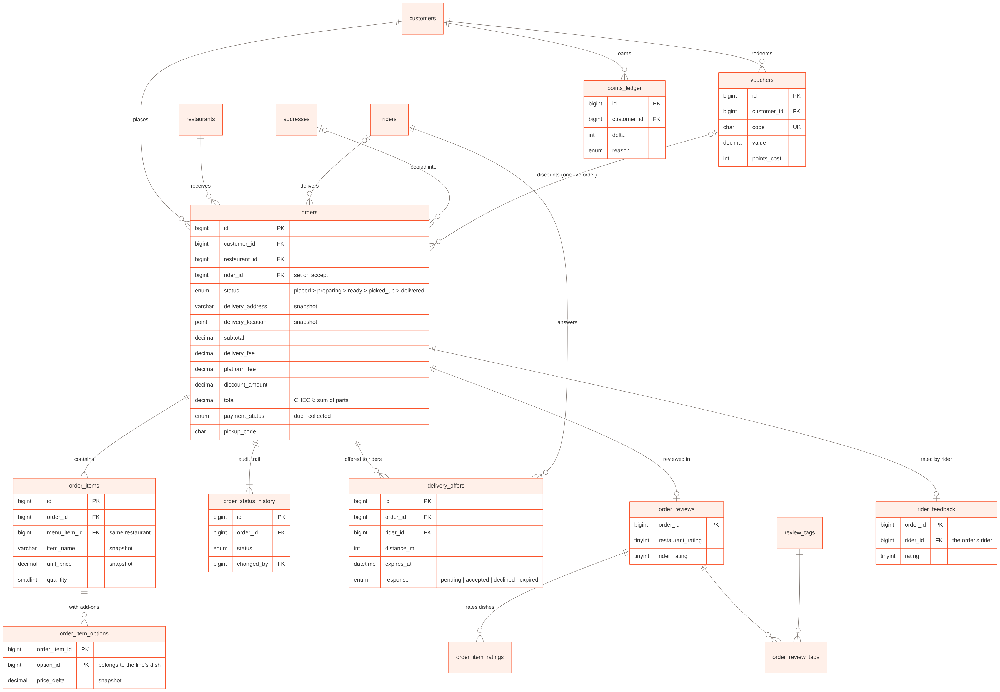
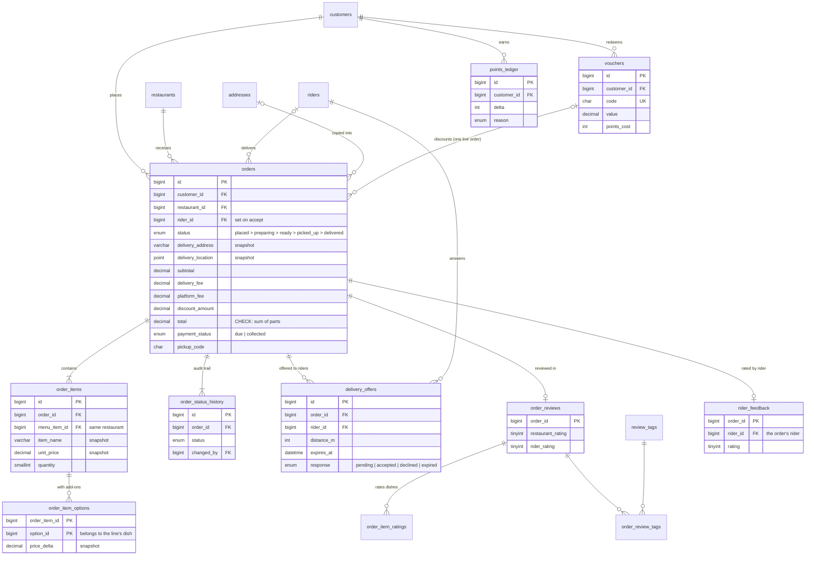

# FoodMind database (MySQL 8.0)

This folder holds the database design for the FoodMind backend:

| File | What it is |
| --- | --- |
| `schema.sql` | Tables, keys, constraints, triggers, procedures and views (33 tables). |
| `seed.sql` | Demo data built from the app's own catalogue: 3 restaurants, 18 dishes, 2 customers, 3 riders, and one order walked through its whole life. All demo passwords are `123456`. |
| `test_schema.py` | 59 checks that try to break each business rule on a real MySQL server. |
| `erd-*.png` | Entity-relationship diagrams (also embedded below as Mermaid). |

```bash
mysql -u root -p < schema.sql
mysql -u root -p < seed.sql
pip install mysql-connector-python && python test_schema.py   # MYSQL_USER / MYSQL_PASSWORD / MYSQL_HOST if not local root
```

Verified on MySQL 8.0.46: the schema and seed load without warnings and all 59 checks pass.

## Requirements this design follows

| Decision | Choice |
| --- | --- |
| Database | MySQL 8.0 (InnoDB, `utf8mb4_0900_ai_ci`) |
| Restaurants | Many restaurants (marketplace); a partner may own several |
| Accounts | One role per account: customer, partner or rider |
| Approval | No admin. A restaurant or rider becomes **active automatically** once its required documents are uploaded |
| Delivery | One delivery type. The system offers each order to the **closest online rider**; the rider accepts or declines; a decline or timeout moves it to the next closest |
| Location | Coordinates come from the location API (device GPS for riders and customers, geocoding for restaurant addresses) |
| Payment | Cash on delivery only |
| Kept features | Reviews & ratings, points & vouchers (vouchers reduce the order total), favourites |
| Dropped | Community delivery, rider bidding, support tickets |

## Entity-relationship diagrams

The schema is shown in three parts. Only key columns are drawn; `schema.sql` has every column.

### 1. Accounts, riders and customers





### 2. Restaurants and menus





### 3. Orders, rider assignment, reviews and points





## How the main flows use the tables

**Sign-up and activation.** A row in `users` plus one row in `customers`, `partners` or `riders`. Partners then create a `restaurants` row (status `draft`) and upload documents. `CALL activate_restaurant(id)` checks for a logo, business licence, owner CNIC, at least one cuisine and opening hours, then sets it `active`; `activate_rider` does the same with the four rider documents. Only active restaurants can switch on `is_accepting_orders`, and only active riders can go online (CHECK constraints).

**Checkout.** The backend inserts one `orders` row and its `order_items` / `order_item_options` in a single transaction, copying names, prices and the delivery address (snapshots). The database rejects the order if the restaurant is closed, the total doesn't add up, a dish or add-on belongs to another restaurant or dish, or the voucher belongs to someone else or is already on another live order.

**Kitchen.** The partner moves the order `placed → preparing` (with `prep_minutes`) `→ ready`, or rejects it; the customer may cancel only while it is `placed`. A trigger refuses any other jump and writes every change to `order_status_history`, recording who made it via `SET @app_user_id = …`.

**Rider assignment.**

1. When the order is accepted, the backend calls `CALL offer_order_to_nearest_rider(order_id, radius_m, timeout_s)`.
2. The procedure finds riders that are active, online, have a GPS fix from the last 2 minutes, carry no active order and have no other open offer. It uses the spatial index to shortlist riders inside a box around the restaurant and ranks them by `ST_Distance_Sphere` (straight-line metres). It then creates one `pending` offer with an expiry time.
3. The rider app answers by updating the offer to `accepted` or `declined`. Accepting (trigger) sets `orders.rider_id` and a 4-digit `pickup_code`. A late acceptance is refused.
4. After a decline, or when the offer expires (the backend's timer), the backend calls the procedure again and the next closest rider is offered. A rider is never offered the same order twice. If nobody is in range, the backend retries later or widens the radius.
5. If road distance or travel time matters, the backend can ask the location API (e.g. a distance-matrix service) to re-rank the closest few candidates before offering. The database stores the result in `delivery_offers.distance_m` and `orders.delivery_distance_m`.

**Delivery.** `ready → picked_up` is impossible without a rider (CHECK). `picked_up → delivered` marks the cash as collected and, through a trigger, adds +20 points to `points_ledger`.

**Reviews and points.** A review can only be written for a delivered order by that order's customer (composite FK plus trigger). The first review adds +20 points. Editing it changes the same row and adds nothing, because the ledger has a unique key per reason and order. `CALL redeem_voucher(customer, points, value, valid_days, @id)` locks the customer row, checks the balance and records the spend, so two taps can't spend the same points twice.

## Design decisions to defend

**1. Supertype/subtype for roles, enforced by the database.** `users` holds what every account has; `customers`, `partners` and `riders` hold role data and are what other tables reference (`orders.customer_id → customers`). Each subtype's foreign key is `(user_id, role) → users(id, role)` with `CHECK (role = 'rider')`, so a customer account can never appear as a rider. One role per account is guaranteed without application code.

**2. Normalised to 3NF; every denormalisation is deliberate.**
- *Order snapshots* (`item_name`, `unit_price`, `option_name`, `price_delta`, delivery address and location): an order is a legal record of what was sold at what price. Menu edits must not rewrite history, which was exactly the bug in the original app where cart prices drifted from the menu.
- *`orders.status`* duplicates the latest row of `order_status_history` so queues ("new orders for restaurant 7") are a single indexed lookup. Triggers keep the two in step.
- *`order_items.restaurant_id`, `options.menu_item_id`* are copies that exist only so composite foreign keys can prove ownership (point 3).
- Balances and ratings are **not** stored. Points are `SUM(points_ledger.delta)` and ratings are `AVG(...)`, exposed as views, so they can never disagree with their source.

**3. Cross-table rules as composite foreign keys.**
- An order's items come from that order's restaurant: `(order_id, restaurant_id) → orders` and `(menu_item_id, restaurant_id) → menu_items`.
- An add-on belongs to the line's dish: `(option_id, menu_item_id) → options`.
- A menu item's category belongs to the same restaurant.
- The order's address and voucher belong to the ordering customer: `(address_id, customer_id)` and `(voucher_id, customer_id)`.
- A review comes from the order's own customer for the order's own restaurant: `(order_id, customer_id, restaurant_id) → orders`.
- Rider feedback comes from the order's own rider.

These are declarative and checked on every insert, regardless of which client writes.

**4. "Only one" rules with generated columns.** MySQL has no partial unique indexes, so a virtual column that is NULL when the rule doesn't apply plus a UNIQUE index gives the same effect:
- one default address per customer;
- one active order per rider (`active_rider_id`);
- one live order per voucher (`active_voucher_id`), so cancelling an order frees its voucher;
- one open offer per order and per rider, and one accepted offer per order;
- unique live dish names while deleted dishes keep their names.

**5. CHECK constraints for single-row rules** (MySQL 8.0.16+ enforces them):
- money adds up (`total = subtotal + delivery_fee + platform_fee − discount_amount`, discount ≤ subtotal);
- a discount needs a voucher;
- ratings are 1–5 and quantities 1–99;
- an order can't be picked up without a rider;
- cash is collected only on delivery;
- only active restaurants and riders can go online;
- an offer has a response time exactly when it was answered.

**6. Triggers only where a rule spans rows or tables:**
- the status lifecycle and its audit trail;
- linking an accepted offer to the order;
- "only delivered orders can be reviewed";
- automatic points;
- refusing orders while a restaurant is closed or a voucher has expired.

**7. Geospatial data done properly.**
- Coordinates are `POINT SRID 4326` (WGS 84, as GPS and mapping APIs return them), with `SPATIAL` indexes on rider, restaurant and order locations.
- `ST_Distance_Sphere` returns metres.
- The rider search first filters with `MBRContains` on a bounding box, and the tests confirm `EXPLAIN` uses `sx_rider_locations_location`. The search therefore does not scan every rider.
- Rider positions live in their own narrow table because they are rewritten every few seconds, and a spatial index requires `NOT NULL`.

**8. ENUMs for closed sets, lookup tables for open ones.** Statuses, roles, document types and vehicle types are fixed by the application's logic, so `ENUM` keeps them compact and self-validating. Cuisines, tags and review tags are data that partners and the product team can grow, so they are lookup tables with many-to-many link tables.

**9. Money and time.** `DECIMAL(10,2)` for every amount (never floating point); `DATETIME` stored in UTC (no 2038 limit).

**10. Soft deletes where history depends on a row.** Menu items and addresses get `deleted_at`, so old orders, favourites and ratings still resolve.

## What stays outside the database

- **Location API**:
  - turning a restaurant's address into coordinates (geocoding);
  - reading device GPS for riders (sent every few seconds into `rider_locations`) and customers;
  - optional road distance and ETA.
- **Timers**: expiring unanswered offers and calling `offer_order_to_nearest_rider` again (or a MySQL `EVENT` if preferred).
- **Authentication**: password hashing (bcrypt/argon2) and tokens; the database stores only `password_hash`.
- **File storage**: documents, photos and delivery proof live in object storage; the database stores their URLs.
- **The cart**: kept in the app until checkout, then written as one order in one transaction.

## From the current app to these tables

| App (Redux slice / AsyncStorage key) | Tables |
| --- | --- |
| `auth`, `foodmind_accounts_v1`, `foodmind_session_v1` | `users`, `customers`, `partners`, `riders` |
| `addresses` (`foodmind_addresses_by_user`) | `addresses` |
| `menu` (`foodmind_partner_menu`) + `foodmind.json` | `menu_categories`, `menu_items`, `tags`, `menu_item_tags`, `option_groups`, `options` |
| `orders` | `orders`, `order_items`, `order_item_options`, `order_status_history` |
| `partner` profile, documents, photos, online switch | `restaurants`, `restaurant_documents`, `restaurant_photos`, `restaurant_cuisines`, `restaurant_hours` |
| `rider` profile, documents, online, deliveries | `riders`, `rider_documents`, `rider_locations`, `delivery_offers`, `orders.rider_id` |
| `customer` reviews, points, redemptions, favourites | `order_reviews`, `order_item_ratings`, `order_review_tags`, `points_ledger`, `vouchers`, `favorite_items`, `favorite_restaurants` |
| Rider bids, community delivery, support reports | Not carried over (dropped from scope) |
